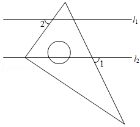
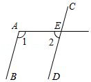

# AVP0148 — Single visual target

MathVista:152 / MathVista:290 · same type · Numeric representation and conversion

## Shared or similar visual information

The numerical notation 2 in both images.

## Evidence locations

- Left image: The standalone 2 below l1, to the left of the triangle's rising side.
- Right image: The standalone 2 below the upper horizontal line, to the left of E.

## Mathematical meanings

Left image: The numeral 2 identifies the adjacent angle region; it is an angle index, not a degree measure. Right image: The numeral 2 identifies the adjacent angle region; it is an angle index, not a degree measure.

## Same mathematical meanings

yes

## Rationales

Both standalone 2s identify an angle region. Their shared role is numbering an angle, not asserting that its size is two degrees.

Only the selected target is annotated. AI visual-review draft; not independently double-annotated by humans.
