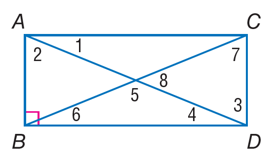
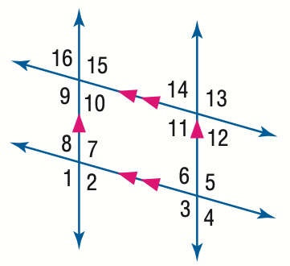

# AVP0149 — Single visual target

MathVista:499 / MathVista:633 · same type · Numeric representation and conversion

## Shared or similar visual information

The numerical notation 8 in both images.

## Evidence locations

- Left image: The standalone 8 inside the right-hand angle at the intersection of the rectangle's diagonals.
- Right image: The standalone 8 above the lower sloping line, to the left of the left vertical line.

## Mathematical meanings

Left image: The numeral 8 identifies the adjacent angle region; it is an angle index, not a degree measure. Right image: The numeral 8 identifies the adjacent angle region; it is an angle index, not a degree measure.

## Same mathematical meanings

yes

## Rationales

Both standalone 8s are angle-region indices. They distinguish which angle is being referred to, without supplying its measure.

Only the selected target is annotated. AI visual-review draft; not independently double-annotated by humans.
