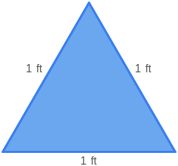

# AVP0151 — Single visual target

MathVista:56 / MathVista:944 · same type · Numeric representation and conversion

## Shared or similar visual information

Numerical notations 1 yd and 1 ft.

## Evidence locations

- Left image: The 1 yd above the top side of the orange rectangle.
- Right image: The 1 ft beside the left side of the blue triangle.

## Mathematical meanings

Left image: The top side has length 1 yard. Right image: The left side has length 1 foot.

## Same mathematical meanings

no

## Rationales

The numeral 1 is shared, but a yard equals three feet. A length of 1 yard and a length of 1 foot are unequal.

Only the selected target is annotated. AI visual-review draft; not independently double-annotated by humans.
