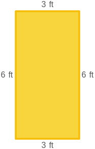
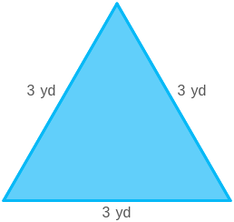

# AVP0152 — Single visual target

MathVista:71 / MathVista:712 · same type · Numeric representation and conversion

## Shared or similar visual information

Numerical notations 3 ft and 3 yd.

## Evidence locations

- Left image: The 3 ft above the top side of the yellow rectangle.
- Right image: The 3 yd beside the left side of the cyan triangle.

## Mathematical meanings

Left image: The top side has length 3 feet. Right image: The left side has length 3 yards.

## Same mathematical meanings

no

## Rationales

The numeral 3 is shared, but feet and yards are different units: 3 yards equals 9 feet, not 3 feet.

Only the selected target is annotated. AI visual-review draft; not independently double-annotated by humans.
