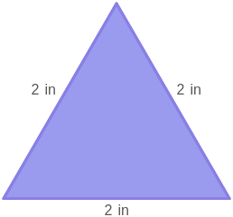
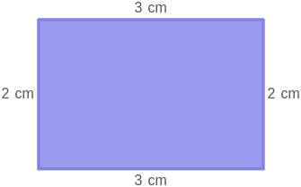

# AVP0153 — Single visual target

MathVista:399 / MathVista:606 · same type · Numeric representation and conversion

## Shared or similar visual information

Numerical notations 2 in and 2 cm.

## Evidence locations

- Left image: The 2 in beside the left side of the purple triangle.
- Right image: The 2 cm beside the left side of the purple rectangle.

## Mathematical meanings

Left image: The left side has length 2 inches. Right image: The left side has length 2 centimeters.

## Same mathematical meanings

no

## Rationales

The numeral 2 is shared, but inches and centimeters denote different lengths: 2 inches equals 5.08 centimeters.

Only the selected target is annotated. AI visual-review draft; not independently double-annotated by humans.
