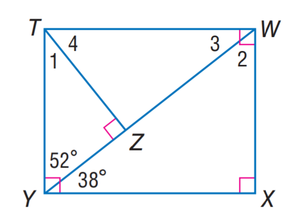
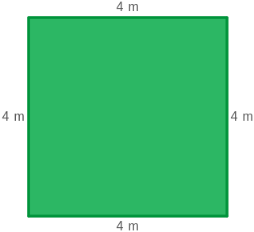

# AVP0154 — Single visual target

MathVista:48 / MathVista:67 · same type · Numeric representation and conversion

## Shared or similar visual information

Numerical notations 4 and 4 m.

## Evidence locations

- Left image: The standalone 4 inside the angle at T, above segment TZ.
- Right image: The 4 m above the top side of the green square.

## Mathematical meanings

Left image: The numeral 4 identifies an angle region at T; it is an angle index, not a degree measure. Right image: The top side has length 4 meters.

## Same mathematical meanings

no

## Rationales

The standalone 4 numbers an angle region in the first image; 4 m quantifies a side length in the second. Angle indexing and length measurement are distinct roles.

Only the selected target is annotated. AI visual-review draft; not independently double-annotated by humans.
