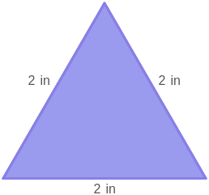

# AVP0155 — Single visual target

MathVista:137 / MathVista:399 · different type · Numeric representation and conversion

## Shared or similar visual information

Numerical notations 2 and 2 in.

## Evidence locations

- Left image: The superscript 2 in f(x)=x² at the upper right.
- Right image: The 2 in beside the left side of the purple triangle.

## Mathematical meanings

Left image: The variable x is squared; 2 is its exponent. Right image: The left side has length 2 inches.

## Same mathematical meanings

no

## Rationales

The selected 2 is a power in x² in the first image, whereas 2 in denotes a side length in the second.

Only the selected target is annotated. AI visual-review draft; not independently double-annotated by humans.
