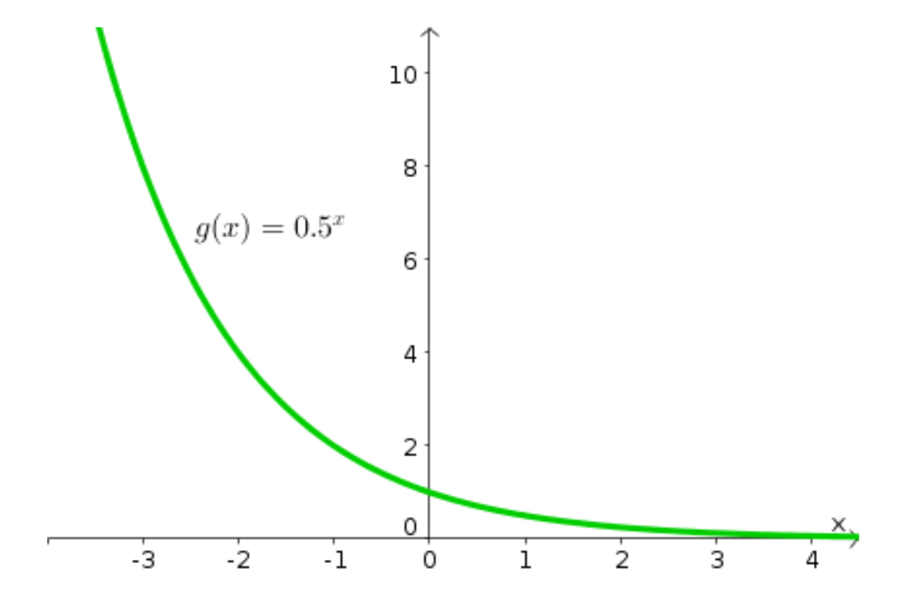
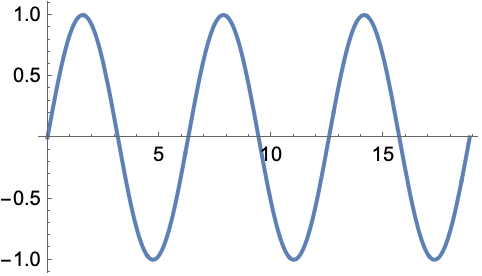

# AVP0157 — Single visual target

MathVista:154 / MathVista:308 · same type · Numeric representation and conversion

## Shared or similar visual information

The numerical notation 0.5.

## Evidence locations

- Left image: The notation 0.5 appears in g(x) = 0.5ˣ.
- Right image: The notation 0.5 appears at the vertical-axis tick midway above the x-axis.

## Mathematical meanings

Left image: 0.5 is the base raised to x in the exponential function. Right image: 0.5 is a vertical-axis coordinate.

## Same mathematical meanings

no

## Rationales

The notation on the left represents an exponential base. The notation on the right represents a vertical coordinate.

Only the selected target is annotated. AI visual-review draft; not independently double-annotated by humans.
