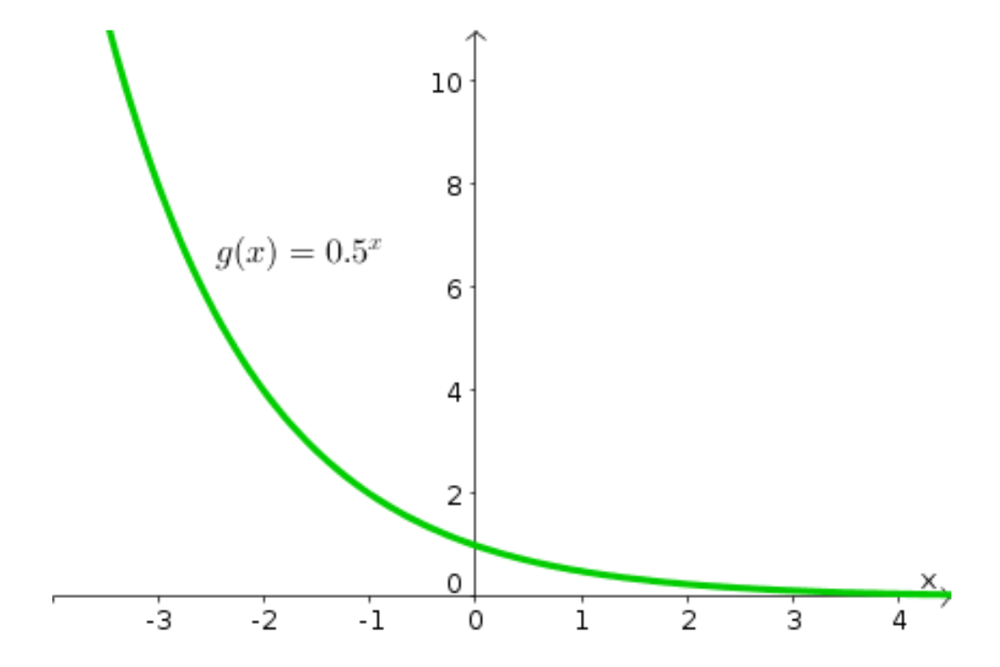

# AVP0157 — Single visual target

MathVista:154 / MathVista:308 · same type · Numeric representation and conversion

## Shared or similar visual information

The numerical notation 0.5 in both images.

## Evidence locations

- Left image: The 0.5 in g(x)=0.5ˣ beside the green curve.
- Right image: The tick label 0.5 halfway up the positive vertical scale.

## Mathematical meanings

Left image: The exponential function has base one half. Right image: The selected tick denotes y-coordinate value 0.5.

## Same mathematical meanings

no

## Rationales

0.5 is an exponential base in the function formula, whereas 0.5 is a vertical coordinate-scale value in the oscillating graph.

Only the selected target is annotated. AI visual-review draft; not independently double-annotated by humans.
