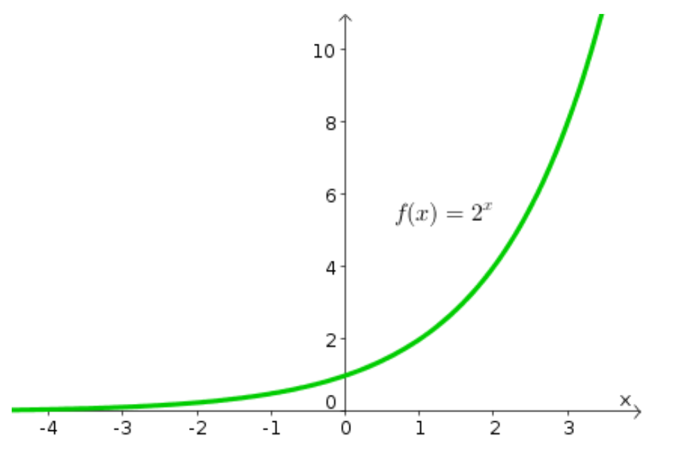
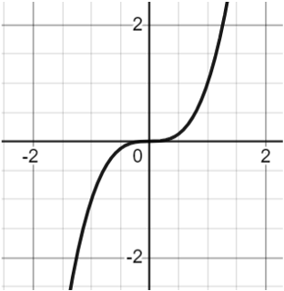

# AVP0158 — Single visual target

MathVista:619 / MathVista:120 · same type · Numeric representation and conversion

## Shared or similar visual information

The numerical notation 2 in both images.

## Evidence locations

- Left image: The 2 in f(x)=2ˣ beside the green curve.
- Right image: The tick label 2 at the positive right side of the horizontal axis.

## Mathematical meanings

Left image: The exponential function has base 2. Right image: The selected tick denotes x-coordinate value 2.

## Same mathematical meanings

no

## Rationales

The selected 2 is an exponential base in 2ˣ, while the selected axis tick denotes x-coordinate 2.

Only the selected target is annotated. AI visual-review draft; not independently double-annotated by humans.
