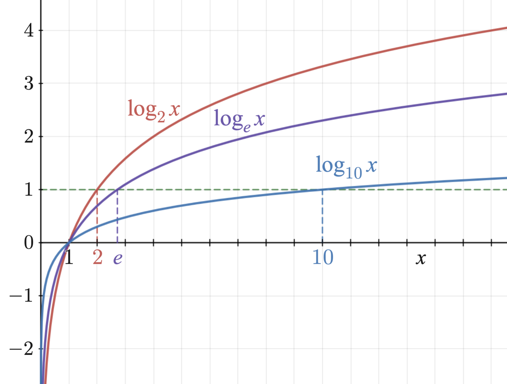

# AVP0160 — Single visual target

MathVista:847 / MathVista:386 · different type · Numeric representation and conversion

## Shared or similar visual information

The numerical notation 10 in both images.

## Evidence locations

- Left image: The subscript 10 in the blue label log₁₀x.
- Right image: The 10 below the bottom side of the tall right triangle.

## Mathematical meanings

Left image: The blue logarithmic curve uses logarithm base 10. Right image: The bottom side has length value 10.

## Same mathematical meanings

no

## Rationales

The selected 10 is the logarithm base in log₁₀x, whereas the triangle label 10 is a side-length value.

Only the selected target is annotated. AI visual-review draft; not independently double-annotated by humans.
