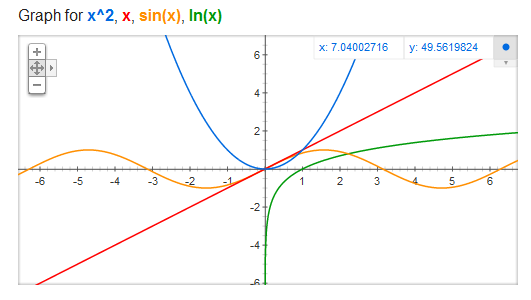

# AVP0161 — Single visual target

MathVista:302 / MathVista:56 · different type · Numeric representation and conversion

## Shared or similar visual information

Numerical notations 2 and 2 yd.

## Evidence locations

- Left image: The superscript 2 in the blue x² item of the graph heading.
- Right image: The 2 yd beside the left side of the orange rectangle.

## Mathematical meanings

Left image: The variable x is squared; 2 is its exponent. Right image: The left side has length 2 yards.

## Same mathematical meanings

no

## Rationales

The selected 2 is an exponent denoting squaring in the plot heading; 2 yd specifies a rectangle side length.

Only the selected target is annotated. AI visual-review draft; not independently double-annotated by humans.
