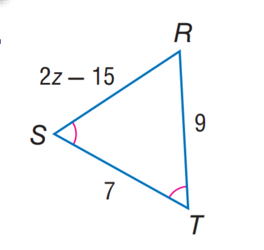

# AVP0162 — Single visual target

MathVista:671 / MathVista:236 · different type · Numeric representation and conversion

## Shared or similar visual information

The numerical notation 9 in both images.

## Evidence locations

- Left image: The 9 at the start of the radicand 9−(x−3)².
- Right image: The 9 beside the right side RT.

## Mathematical meanings

Left image: The radicand has additive constant term 9. Right image: Segment RT has length value 9.

## Same mathematical meanings

no

## Rationales

The selected 9 is an additive constant inside a function formula's radicand, while 9 beside RT specifies that segment's length.

Only the selected target is annotated. AI visual-review draft; not independently double-annotated by humans.
