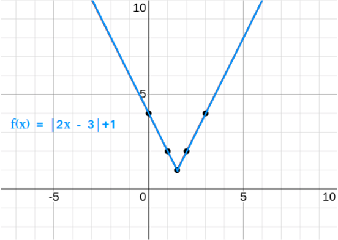

# AVP0163 — Single visual target

MathVista:23 / MathVista:633 · different type · Numeric representation and conversion

## Shared or similar visual information

The numerical notation 2 in both images.

## Evidence locations

- Left image: The coefficient 2 in f(x)=|2x−3|+1 beside the graph.
- Right image: The standalone 2 below the lower sloping line, to the right of the left vertical line.

## Mathematical meanings

Left image: The variable x is multiplied by coefficient 2 within the absolute value. Right image: The numeral 2 identifies the adjacent angle region; it is an angle index, not a degree measure.

## Same mathematical meanings

no

## Rationales

The selected 2 multiplies x in the function expression, while the standalone 2 in the line diagram identifies an angle region.

Only the selected target is annotated. AI visual-review draft; not independently double-annotated by humans.
