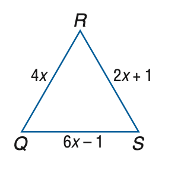

# AVP0164 — Single visual target

MathVista:176 / MathVista:409 · same type · Numeric representation and conversion

## Shared or similar visual information

The numerical notation 4 in both images.

## Evidence locations

- Left image: The coefficient 4 in the side-length expression 4x on RQ.
- Right image: The tick label 4 on the positive vertical axis, left of the circle.

## Mathematical meanings

Left image: The unknown x is multiplied by coefficient 4 in the length expression. Right image: The selected tick denotes y-coordinate value 4.

## Same mathematical meanings

no

## Rationales

The selected 4 multiplies an unknown in a side-length expression; the other 4 is a y-axis coordinate-scale value.

Only the selected target is annotated. AI visual-review draft; not independently double-annotated by humans.
