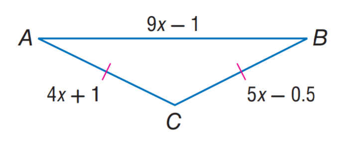

# AVP0165 — Single visual target

MathVista:375 / MathVista:308 · different type · Numeric representation and conversion

## Shared or similar visual information

Numerical notations −0.5 and 0.5.

## Evidence locations

- Left image: The signed additive term −0.5 in 5x−0.5 on the right side.
- Right image: The tick label 0.5 halfway up the positive vertical scale.

## Mathematical meanings

Left image: The length expression has additive constant negative one half. Right image: The selected tick denotes y-coordinate value 0.5.

## Same mathematical meanings

no

## Rationales

The complete signed constant is −0.5 in the length expression, whereas the vertical coordinate label is positive 0.5. Both sign and local role differ.

Only the selected target is annotated. AI visual-review draft; not independently double-annotated by humans.
