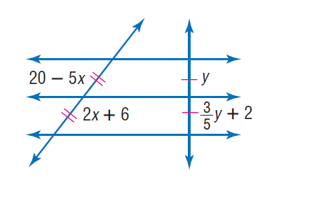
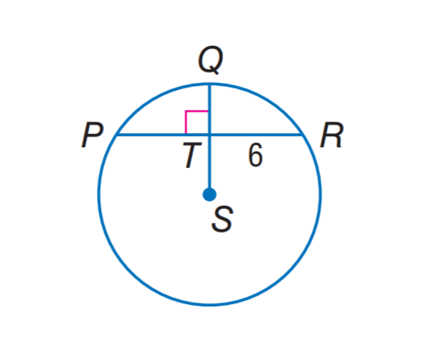

# AVP0166 — Single visual target

MathVista:271 / MathVista:990 · same type · Numeric representation and conversion

## Shared or similar visual information

The numerical notation 6 in both images.

## Evidence locations

- Left image: The additive 6 in the lower slanted-segment label 2x+6.
- Right image: The 6 beside chord portion TR to the right of the vertical diameter.

## Mathematical meanings

Left image: The segment-length expression has additive constant 6. Right image: Segment TR has length value 6.

## Same mathematical meanings

no

## Rationales

The selected 6 is an additive constant within 2x+6; the isolated 6 beside TR is the length value of the entire segment.

Only the selected target is annotated. AI visual-review draft; not independently double-annotated by humans.
