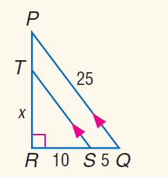

# AVP0167 — Single visual target

MathVista:238 / MathVista:938 · same type · Numeric representation and conversion

## Shared or similar visual information

The numerical notation 5 in both images.

## Evidence locations

- Left image: The 5 below the short bottom segment SQ.
- Right image: The standalone 5 above transversal t, to the left of the middle vertical line m.

## Mathematical meanings

Left image: Segment SQ has length value 5. Right image: The numeral 5 identifies the adjacent angle region; it is an angle index, not a degree measure.

## Same mathematical meanings

no

## Rationales

The selected 5 quantifies the length of SQ; the standalone 5 at the line crossing is an angle index and gives no measured angle value.

Only the selected target is annotated. AI visual-review draft; not independently double-annotated by humans.
