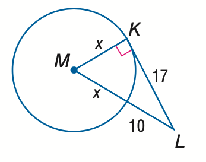
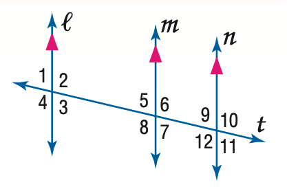

# AVP0168 — Single visual target

MathVista:114 / MathVista:938 · same type · Numeric representation and conversion

## Shared or similar visual information

The numerical notation 10 in both images.

## Evidence locations

- Left image: The 10 beside the exterior part of the secant from L toward the circle.
- Right image: The standalone 10 above transversal t, to the right of the rightmost vertical line n.

## Mathematical meanings

Left image: The exterior secant segment has length value 10. Right image: The numeral 10 identifies the adjacent angle region; it is an angle index, not a degree measure.

## Same mathematical meanings

no

## Rationales

The selected 10 is a segment-length value on a secant; the other 10 names an angle region at a line crossing.

Only the selected target is annotated. AI visual-review draft; not independently double-annotated by humans.
