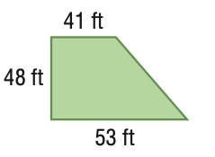
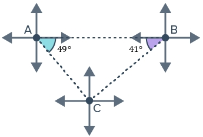

# AVP0169 — Single visual target

MathVista:318 / MathVerse:339 · same type · Numeric representation and conversion

## Shared or similar visual information

Numerical notations 41 ft and 41°.

## Evidence locations

- Left image: The 41 ft above the trapezoid's top edge.
- Right image: The 41° in the small angle region at B.

## Mathematical meanings

Left image: The top edge has length 41 feet. Right image: The selected angle at B measures 41 degrees.

## Same mathematical meanings

no

## Rationales

The numeral 41 is shared, but 41 ft is a side length and 41° is an angle measure.

Only the selected target is annotated. AI visual-review draft; not independently double-annotated by humans.
