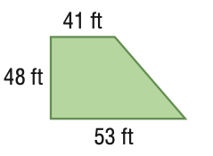
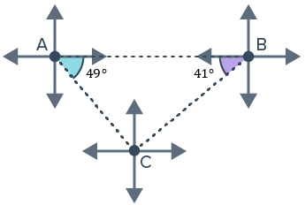

# AVP0169 — Single visual target

MathVista:318 / MathVerse:339 · same type · Numeric representation and conversion

## Shared or similar visual information

The numerical notations 41 ft (left) and 41° (right).

## Evidence locations

- Left image: The notation 41 ft appears above the trapezoid.
- Right image: The notation 41° appears beside the purple wedge at B.

## Mathematical meanings

Left image: 41 ft gives the upper base length. Right image: 41° measures the angle between the westward ray and BC.

## Same mathematical meanings

no

## Rationales

The notation on the left represents a segment length. The notation on the right represents an angle measure.

Only the selected target is annotated. AI visual-review draft; not independently double-annotated by humans.
