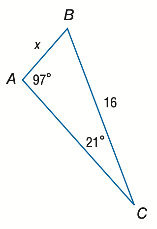
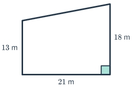

# AVP0170 — Single visual target

MathVista:583 / MathVerse:363 · same type · Numeric representation and conversion

## Shared or similar visual information

The numerical notations 21° (left) and 21 m (right).

## Evidence locations

- Left image: The notation 21° appears near the lower-right angle at C.
- Right image: The notation 21 m appears below the quadrilateral.

## Mathematical meanings

Left image: 21° measures the angle at C. Right image: 21 m measures the bottom edge.

## Same mathematical meanings

no

## Rationales

The notation on the left represents an angle measure. The notation on the right represents a segment length.

Only the selected target is annotated. AI visual-review draft; not independently double-annotated by humans.
