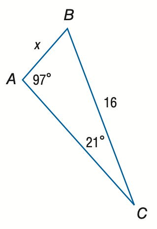
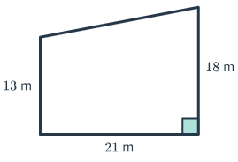

# AVP0170 — Single visual target

MathVista:583 / MathVerse:363 · same type · Numeric representation and conversion

## Shared or similar visual information

Numerical notations 21° and 21 m.

## Evidence locations

- Left image: The 21° at the narrow bottom vertex C.
- Right image: The 21 m below the quadrilateral's lower horizontal side.

## Mathematical meanings

Left image: The triangle angle at C measures 21 degrees. Right image: The lower side has length 21 meters.

## Same mathematical meanings

no

## Rationales

The numeral 21 is shared, but 21° measures an angle while 21 m measures a side length.

Only the selected target is annotated. AI visual-review draft; not independently double-annotated by humans.
