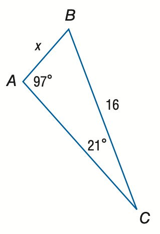

# AVP0171 — Single visual target

MathVista:583 / MathVista:633 · same type · Numeric representation and conversion

## Shared or similar visual information

The numerical notation 16 in both images.

## Evidence locations

- Left image: The 16 beside side BC.
- Right image: The standalone 16 above the upper sloping line, to the left of the left vertical line.

## Mathematical meanings

Left image: Segment BC has length value 16. Right image: The numeral 16 identifies the adjacent angle region; it is an angle index, not a degree measure.

## Same mathematical meanings

no

## Rationales

The selected 16 is a triangle side-length value; the other 16 is an angle-region identifier, not a length or degree measure.

Only the selected target is annotated. AI visual-review draft; not independently double-annotated by humans.
