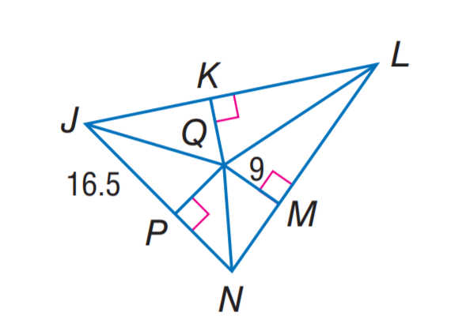

# AVP0172 — Single visual target

MathVista:776 / MathVista:938 · same type · Numeric representation and conversion

## Shared or similar visual information

The numerical notation 9 in both images.

## Evidence locations

- Left image: The 9 between Q and M, beside the short perpendicular segment.
- Right image: The standalone 9 above transversal t, to the left of the rightmost vertical line n.

## Mathematical meanings

Left image: Segment QM has length value 9. Right image: The numeral 9 identifies the adjacent angle region; it is an angle index, not a degree measure.

## Same mathematical meanings

no

## Rationales

The selected 9 gives the length value of QM; the other 9 identifies an angle region formed by crossing lines.

Only the selected target is annotated. AI visual-review draft; not independently double-annotated by humans.
