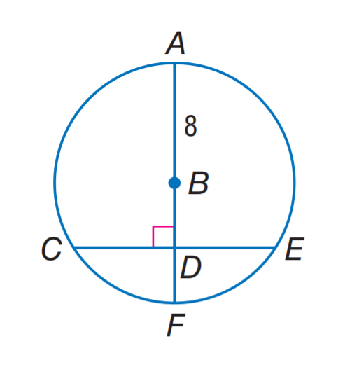
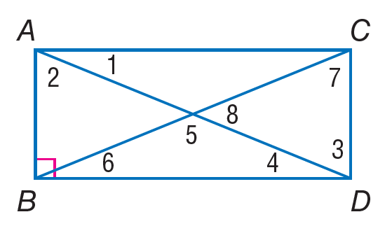

# AVP0173 — Single visual target

MathVista:804 / MathVista:499 · same type · Numeric representation and conversion

## Shared or similar visual information

The numerical notation 8 in both images.

## Evidence locations

- Left image: The 8 beside the radius AB at the upper center of the circle.
- Right image: The standalone 8 inside the right-hand angle at the intersection of the rectangle's diagonals.

## Mathematical meanings

Left image: Radius AB has length value 8. Right image: The numeral 8 identifies the adjacent angle region; it is an angle index, not a degree measure.

## Same mathematical meanings

no

## Rationales

The selected 8 gives radius AB's length value; the other 8 labels an angle region at the intersection of diagonals.

Only the selected target is annotated. AI visual-review draft; not independently double-annotated by humans.
