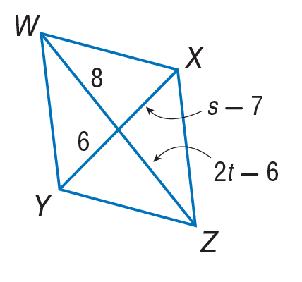

# AVP0174 — Single visual target

MathVista:819 / MathVista:633 · same type · Numeric representation and conversion

## Shared or similar visual information

The numerical notation 6 in both images.

## Evidence locations

- Left image: The 6 beside the lower-left half of diagonal YX.
- Right image: The standalone 6 above the lower sloping line, to the left of the right vertical line.

## Mathematical meanings

Left image: The segment from Y to the intersection of the diagonals has length value 6. Right image: The numeral 6 identifies the adjacent angle region; it is an angle index, not a degree measure.

## Same mathematical meanings

no

## Rationales

The selected 6 quantifies a diagonal portion's length, whereas the other 6 is an angle index.

Only the selected target is annotated. AI visual-review draft; not independently double-annotated by humans.
