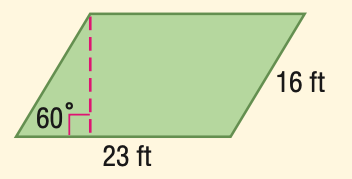

# AVP0175 — Single visual target

MathVista:737 / MathVista:633 · same type · Numeric representation and conversion

## Shared or similar visual information

Numerical notations 16 ft and 16.

## Evidence locations

- Left image: The 16 ft beside the right sloping side of the green parallelogram.
- Right image: The standalone 16 above the upper sloping line, to the left of the left vertical line.

## Mathematical meanings

Left image: The right side has length 16 feet. Right image: The numeral 16 identifies the adjacent angle region; it is an angle index, not a degree measure.

## Same mathematical meanings

no

## Rationales

16 ft specifies a side length, whereas the standalone 16 is a label identifying an angle region.

Only the selected target is annotated. AI visual-review draft; not independently double-annotated by humans.
