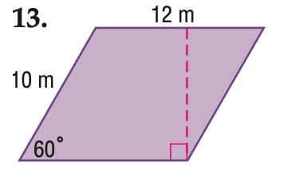

# AVP0176 — Single visual target

MathVista:822 / MathVista:938 · same type · Numeric representation and conversion

## Shared or similar visual information

Numerical notations 12 m and 12.

## Evidence locations

- Left image: The 12 m above the upper horizontal side of the purple parallelogram.
- Right image: The standalone 12 below transversal t, to the left of the rightmost vertical line n.

## Mathematical meanings

Left image: The top side has length 12 meters. Right image: The numeral 12 identifies the adjacent angle region; it is an angle index, not a degree measure.

## Same mathematical meanings

no

## Rationales

12 m specifies the top side's length; the standalone 12 in the other diagram is an angle-region identifier.

Only the selected target is annotated. AI visual-review draft; not independently double-annotated by humans.
