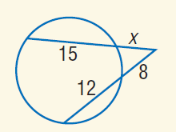

# AVP0177 — Single visual target

MathVista:757 / MathVista:938 · same type · Numeric representation and conversion

## Shared or similar visual information

The numerical notation 12 in both images.

## Evidence locations

- Left image: The 12 on the lower secant portion inside the circle.
- Right image: The standalone 12 below transversal t, to the left of the rightmost vertical line n.

## Mathematical meanings

Left image: The internal portion of the lower secant has length value 12. Right image: The numeral 12 identifies the adjacent angle region; it is an angle index, not a degree measure.

## Same mathematical meanings

no

## Rationales

The selected 12 gives an internal secant portion's length value; the other 12 merely identifies a particular angle region.

Only the selected target is annotated. AI visual-review draft; not independently double-annotated by humans.
