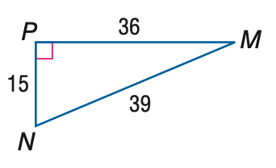
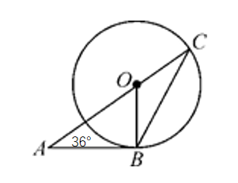

# AVP0178 — Single visual target

MathVista:388 / MathVerse:4 · same type · Numeric representation and conversion

## Shared or similar visual information

Numerical notations 36 and 36°.

## Evidence locations

- Left image: The 36 above the top side PM.
- Right image: The 36° at the lower-left vertex A.

## Mathematical meanings

Left image: Segment PM has length value 36. Right image: The marked triangle angle at A measures 36 degrees.

## Same mathematical meanings

no

## Rationales

The same numeral 36 denotes a segment-length value in the first image and an angle's degree measure in the second.

Only the selected target is annotated. AI visual-review draft; not independently double-annotated by humans.
