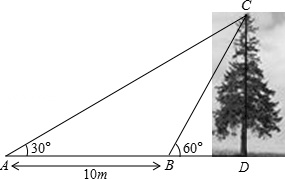
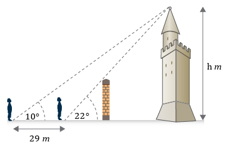

# AVP0179 — Single visual target

MathVista:523 / MathVerse:361 · same type · Numeric representation and conversion

## Shared or similar visual information

Numerical notations 10 m and 10°.

## Evidence locations

- Left image: The 10 m below the dimension arrow between A and B.
- Right image: The 10° beside the leftmost observer on the ground.

## Mathematical meanings

Left image: The horizontal distance AB is 10 meters. Right image: The marked angle of elevation at that observer measures 10 degrees.

## Same mathematical meanings

no

## Rationales

10 m measures a horizontal distance, whereas 10° measures an angle of elevation.

Only the selected target is annotated. AI visual-review draft; not independently double-annotated by humans.
