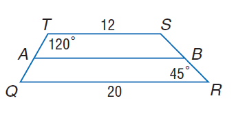
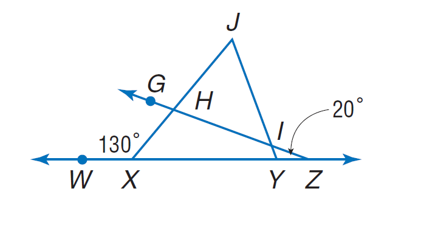

# AVP0180 — Single visual target

MathVista:866 / MathVista:360 · same type · Numeric representation and conversion

## Shared or similar visual information

Numerical notations 20 and 20°.

## Evidence locations

- Left image: The 20 below the trapezoid's bottom side QR.
- Right image: The 20° with a leader pointing to the small angle at Y.

## Mathematical meanings

Left image: Segment QR has length value 20. Right image: The selected angle at Y measures 20 degrees.

## Same mathematical meanings

no

## Rationales

The isolated 20 below QR is a length value; 20° beside Y is an angle measure.

Only the selected target is annotated. AI visual-review draft; not independently double-annotated by humans.
