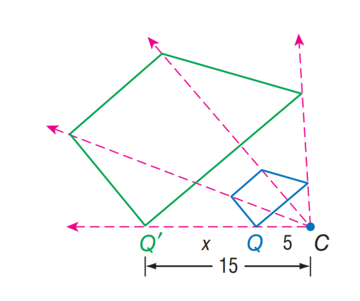

# AVP0181 — Single visual target

MathVista:206 / MathVista:23 · different type · Numeric representation and conversion

## Shared or similar visual information

The numerical notation 5 in both images.

## Evidence locations

- Left image: The 5 on the horizontal baseline between Q and C.
- Right image: The tick label 5 above the origin on the vertical axis.

## Mathematical meanings

Left image: Segment QC has length value 5. Right image: The selected tick denotes y-coordinate value 5.

## Same mathematical meanings

no

## Rationales

The selected 5 quantifies segment QC's length, while the other 5 denotes a y-coordinate on the graph's vertical scale.

Only the selected target is annotated. AI visual-review draft; not independently double-annotated by humans.
