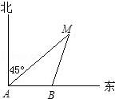
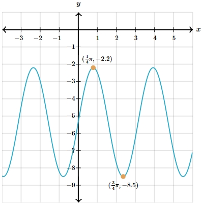

# AVP0184 — Single visual target

MathVista:587 / MathVerse:530 · different type · Numeric representation and conversion

## Shared or similar visual information

Numerical notations 45° and (1/4)π.

## Evidence locations

- Left image: The 45° between the north-pointing ray and ray AM, at A.
- Right image: The first component (1/4)π of the upper orange point's coordinate label.

## Mathematical meanings

Left image: The marked angle at A measures 45 degrees. Right image: The marked upper point has x-coordinate π/4.

## Same mathematical meanings

no

## Rationales

45° and π/4 are numerically equivalent as an angle conversion, but the first is an angle measure and the second is a point's x-coordinate.

Only the selected target is annotated. AI visual-review draft; not independently double-annotated by humans.
