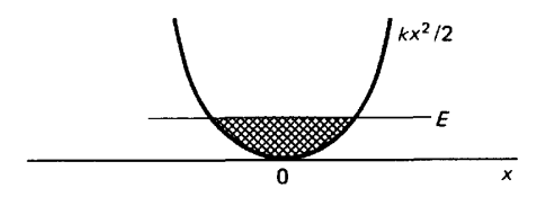
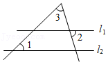

# AVP0185 — Single visual target

MathVista:997 / MathVista:149 · different type · Numeric representation and conversion

## Shared or similar visual information

The numerical notation 2 in both images.

## Evidence locations

- Left image: The denominator 2 in the label kx²/2 beside the parabola.
- Right image: The standalone 2 below l1, to the right of the triangle's descending side.

## Mathematical meanings

Left image: The expression kx² is divided by 2. Right image: The numeral 2 identifies the adjacent angle region; it is an angle index, not a degree measure.

## Same mathematical meanings

no

## Rationales

The denominator 2 divides kx² in a formula; the standalone 2 in the other image identifies an angle region.

Only the selected target is annotated. AI visual-review draft; not independently double-annotated by humans.
