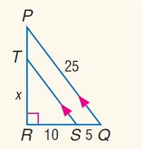

# AVP0186 — Single visual target

MathVista:767 / MathVista:238 · same type · Numeric representation and conversion

## Shared or similar visual information

The numerical notation 25 in both images.

## Evidence locations

- Left image: The 25 on the right of the circle equation x²+y²=25.
- Right image: The 25 beside the outer hypotenuse PQ.

## Mathematical meanings

Left image: The number 25 is the constant on the right-hand side of the circle equation. Right image: Segment PQ has length value 25.

## Same mathematical meanings

no

## Rationales

25 is the constant on the right-hand side of the circle equation, whereas the other 25 gives hypotenuse PQ's length.

Only the selected target is annotated. AI visual-review draft; not independently double-annotated by humans.
