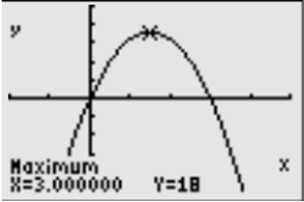
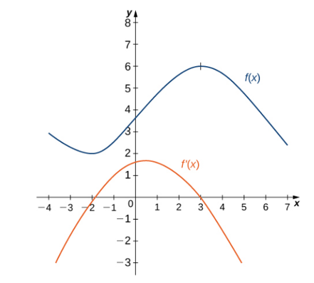

# AVP0188 — Single visual target

MathVista:217 / MathVista:963 · same type · Numeric representation and conversion

## Shared or similar visual information

Numerical notations 3.000000 and 3.

## Evidence locations

- Left image: The X=3.000000 readout below the graph, next to Maximum.
- Right image: The tick label 3 on the vertical axis above 2 and below 4.

## Mathematical meanings

Left image: The marked maximum point has x-coordinate 3. Right image: The selected tick denotes y-coordinate value 3.

## Same mathematical meanings

no

## Rationales

3.000000 equals 3, but the readout gives a maximum point's x-coordinate while the other label is a y-coordinate-scale value.

Only the selected target is annotated. AI visual-review draft; not independently double-annotated by humans.
