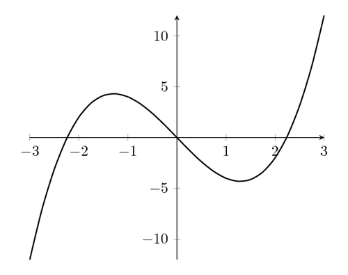
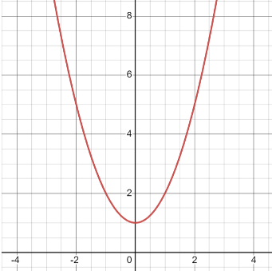

# AVP0189 — Single visual target

MathVista:762 / MathVista:346 · same type · Numeric representation and conversion

## Shared or similar visual information

Numerical notations −2 and 2.

## Evidence locations

- Left image: The tick label −2 to the left of the origin on the horizontal axis.
- Right image: The tick label 2 to the right of the origin on the horizontal axis.

## Mathematical meanings

Left image: The selected tick denotes x-coordinate value −2. Right image: The selected tick denotes x-coordinate value 2.

## Same mathematical meanings

no

## Rationales

The coordinate roles match, but the complete signed values −2 and 2 are unequal. Their common digit does not remove the minus sign.

Only the selected target is annotated. AI visual-review draft; not independently double-annotated by humans.
