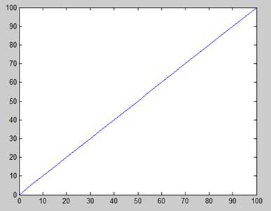
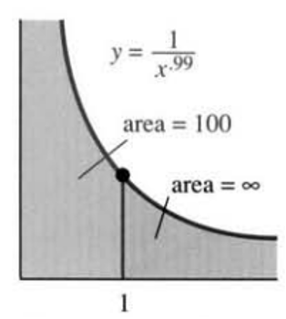

# AVP0190 — Single visual target

MathVista:962 / MathVista:717 · same type · Numeric representation and conversion

## Shared or similar visual information

The numerical notation 100 in both images.

## Evidence locations

- Left image: The tick label 100 at the top-left of the square graph frame.
- Right image: The 100 in the annotation area=100 pointing to the gray region.

## Mathematical meanings

Left image: The selected tick denotes y-coordinate value 100. Right image: The indicated gray region is assigned finite area value 100.

## Same mathematical meanings

no

## Rationales

The first 100 is a y-coordinate-scale value; the other 100 labels the area of a shaded region. Coordinate scale and area are distinct quantities.

Only the selected target is annotated. AI visual-review draft; not independently double-annotated by humans.
