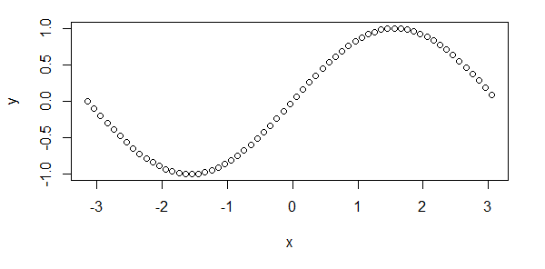
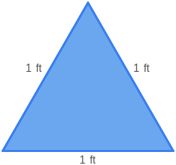

# AVP0191 — Single visual target

MathVista:118 / MathVista:944 · different type · Numeric representation and conversion

## Shared or similar visual information

Numerical notations 1.0 and 1 ft.

## Evidence locations

- Left image: The tick label 1.0 at the top of the vertical scale.
- Right image: The 1 ft beside the left side of the blue triangle.

## Mathematical meanings

Left image: The selected tick denotes y-coordinate value 1.0. Right image: The left side has length 1 foot.

## Same mathematical meanings

no

## Rationales

1.0 equals 1 numerically, but the first label denotes a y-coordinate and 1 ft denotes a side length.

Only the selected target is annotated. AI visual-review draft; not independently double-annotated by humans.
