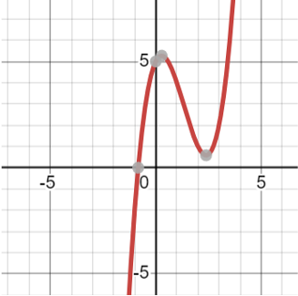
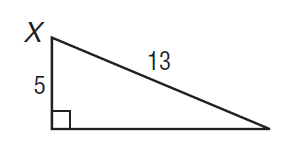

# AVP0192 — Single visual target

MathVista:65 / MathVista:333 · different type · Numeric representation and conversion

## Shared or similar visual information

The numerical notation 5 in both images.

## Evidence locations

- Left image: The tick label 5 at the positive vertical axis beside the upper gray point.
- Right image: The 5 beside the short vertical leg of the right triangle.

## Mathematical meanings

Left image: The selected tick denotes y-coordinate value 5. Right image: The vertical leg has length value 5.

## Same mathematical meanings

no

## Rationales

The selected 5 on the vertical axis denotes a y-coordinate-scale value; the other 5 specifies a triangle leg's length.

Only the selected target is annotated. AI visual-review draft; not independently double-annotated by humans.
