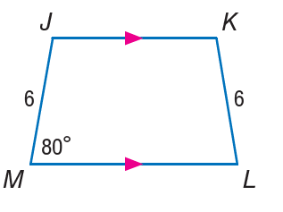

# AVP0195 — Single visual target

MathVista:671 / MathVista:786 · different type · Numeric representation and conversion

## Shared or similar visual information

The numerical notation 6 in both images.

## Evidence locations

- Left image: The tick label 6 below the right endpoint of the semicircle.
- Right image: The 6 beside the left leg JM of the trapezoid.

## Mathematical meanings

Left image: The selected tick denotes x-coordinate value 6. Right image: Segment JM has length value 6.

## Same mathematical meanings

no

## Rationales

The first 6 is the x-coordinate at the semicircle's right end; the other 6 is the length value of trapezoid leg JM.

Only the selected target is annotated. AI visual-review draft; not independently double-annotated by humans.
