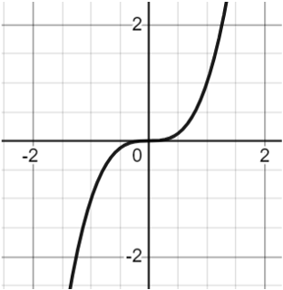
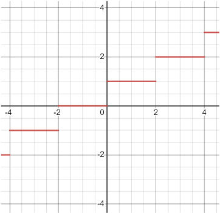

# AVP0197 — Single visual target

MathVista:120 / MathVista:720 · same type · Numeric representation and conversion

## Shared or similar visual information

Numerical notations −2 and 2.

## Evidence locations

- Left image: The tick label −2 below the origin on the vertical axis.
- Right image: The tick label 2 on the positive vertical axis.

## Mathematical meanings

Left image: The selected tick denotes y-coordinate value −2. Right image: The selected tick denotes y-coordinate value 2.

## Same mathematical meanings

no

## Rationales

Both labels are on vertical coordinate scales, but −2 and 2 differ in sign and value.

Only the selected target is annotated. AI visual-review draft; not independently double-annotated by humans.
