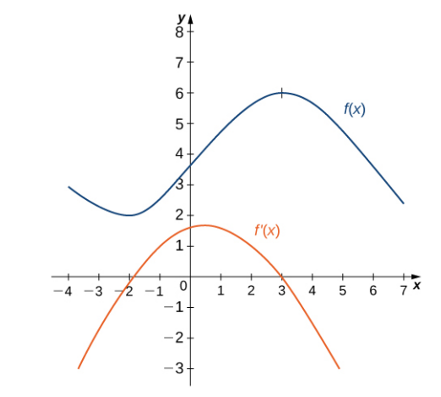

# AVP0198 — Single visual target

MathVista:963 / MathVista:329 · same type · Numeric representation and conversion

## Shared or similar visual information

The numerical notation 4 in both images.

## Evidence locations

- Left image: The tick label 4 on the vertical axis above 3 and below 5.
- Right image: The tick label 4 below the middle marked point of the logarithmic curve.

## Mathematical meanings

Left image: The selected tick denotes y-coordinate value 4. Right image: The selected tick denotes x-coordinate value 4.

## Same mathematical meanings

no

## Rationales

The number 4 is shared, but one selected label denotes a y-coordinate and the other an x-coordinate.

Only the selected target is annotated. AI visual-review draft; not independently double-annotated by humans.
