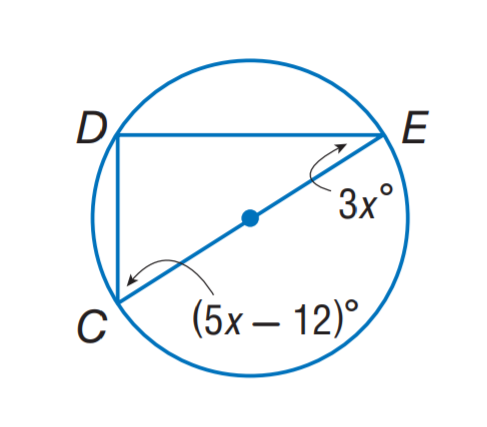

# AVP0199 — Single visual target

MathVista:951 / MathVista:441 · same type · Numeric representation and conversion

## Shared or similar visual information

Numerical notations 3 and 3 cm.

## Evidence locations

- Left image: The coefficient 3 in 3x° at the circle's upper-right angle.
- Right image: The 3 cm beside the left side of the cyan triangle.

## Mathematical meanings

Left image: The unknown x is multiplied by coefficient 3 in an angle-measure expression. Right image: The left side has length 3 centimeters.

## Same mathematical meanings

no

## Rationales

The selected 3 multiplies x in the angle expression 3x°; 3 cm specifies a side's length. A coefficient is not a measured side length.

Only the selected target is annotated. AI visual-review draft; not independently double-annotated by humans.
