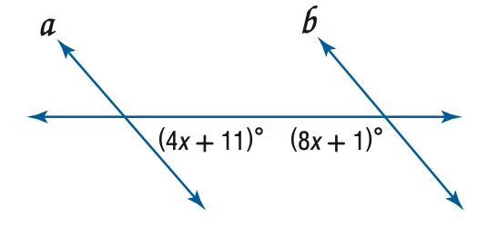
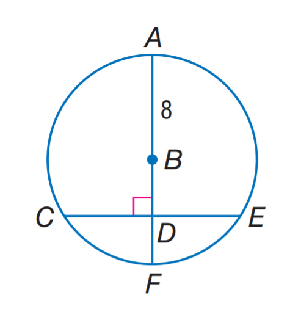

# AVP0200 — Single visual target

MathVista:855 / MathVista:804 · same type · Numeric representation and conversion

## Shared or similar visual information

The numerical notation 8 in both images.

## Evidence locations

- Left image: The coefficient 8 in (8x+1)° beneath the right crossing.
- Right image: The 8 beside the radius AB at the upper center of the circle.

## Mathematical meanings

Left image: The unknown x is multiplied by coefficient 8 in an angle-measure expression. Right image: Radius AB has length value 8.

## Same mathematical meanings

no

## Rationales

The selected 8 multiplies x in an angle-measure expression; the isolated 8 on radius AB gives a segment-length value.

Only the selected target is annotated. AI visual-review draft; not independently double-annotated by humans.
