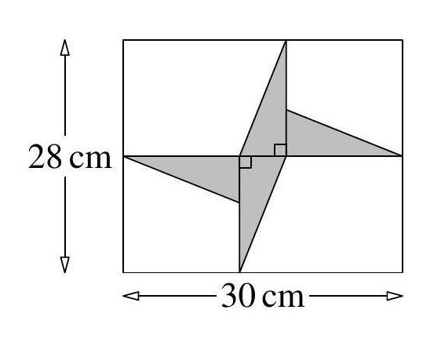
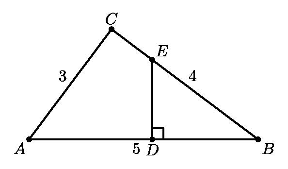

# AVP0201 — Single visual target

MathVision:1774 / MathVision:2180 · same type · Geometric markers

## Shared or similar visual information

A small square or rotated-square angle marker where two lines meet.

## Evidence locations

- Left image: The lower of the two tiny square marks at the central crossing of the horizontal and vertical internal lines.
- Right image: The small square at D where ED meets the horizontal base AB.

## Mathematical meanings

Left image: The intersecting horizontal and vertical internal lines are perpendicular. Right image: ED is perpendicular to AB at D.

## Same mathematical meanings

yes

## Rationales

In both locations the square is attached to the angle between the intersecting lines, so the conventional symbol asserts perpendicularity. Rotation, fill and the surrounding construction do not change the right-angle meaning.

Only the selected target is annotated. AI visual-review draft; not independently double-annotated by humans.
