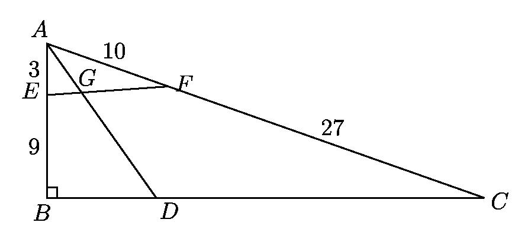
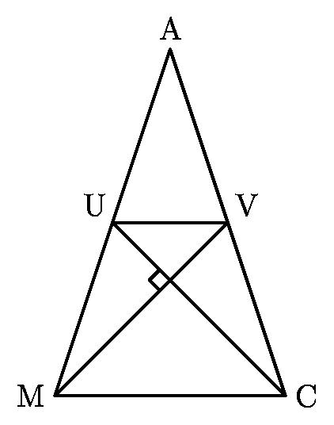

# AVP0202 — Single visual target

MathVision:2063 / MathVision:2226 · same type · Geometric markers

## Shared or similar visual information

A small square or rotated-square angle marker where two lines meet.

## Evidence locations

- Left image: The small outlined square at B, where AB meets BC.
- Right image: The tilted small square where UC crosses MV inside the triangle.

## Mathematical meanings

Left image: AB is perpendicular to BC at B. Right image: UC is perpendicular to MV at their intersection.

## Same mathematical meanings

yes

## Rationales

In both locations the square is attached to the angle between the intersecting lines, so the conventional symbol asserts perpendicularity. Rotation, fill and the surrounding construction do not change the right-angle meaning.

Only the selected target is annotated. AI visual-review draft; not independently double-annotated by humans.
