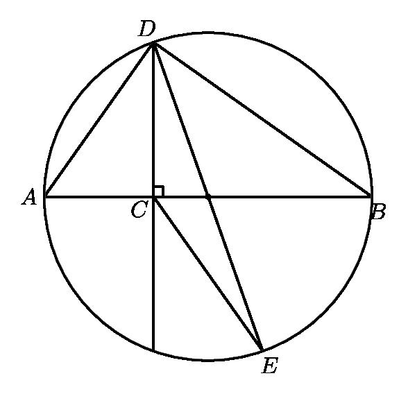
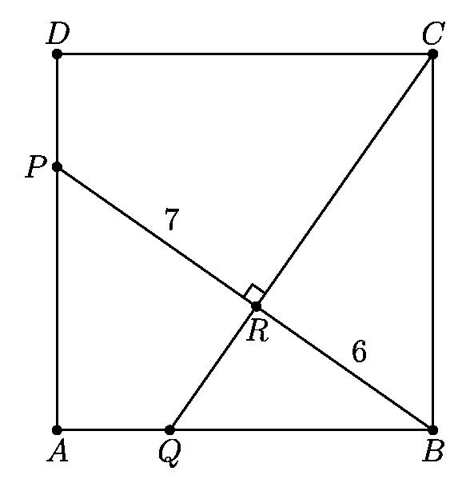

# AVP0204 — Single visual target

MathVision:2147 / MathVision:2235 · same type · Geometric markers

## Shared or similar visual information

A small square or rotated-square angle marker where two lines meet.

## Evidence locations

- Left image: The small black square beside C, where the vertical diameter line meets AB.
- Right image: The tilted square at R, where PB crosses CQ.

## Mathematical meanings

Left image: The line through D, C and E is perpendicular to AB at C. Right image: PB is perpendicular to CQ at R.

## Same mathematical meanings

yes

## Rationales

In both locations the square is attached to the angle between the intersecting lines, so the conventional symbol asserts perpendicularity. Rotation, fill and the surrounding construction do not change the right-angle meaning.

Only the selected target is annotated. AI visual-review draft; not independently double-annotated by humans.
